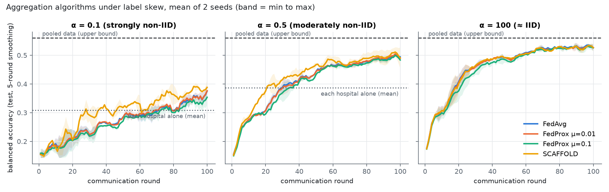
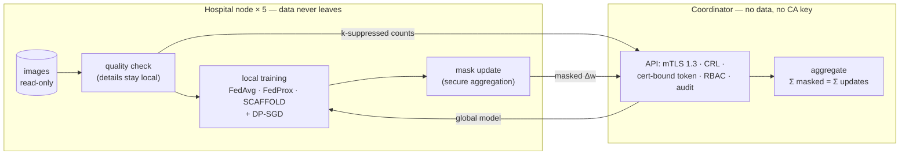

# fedmed: federated skin-lesion classification with real security

[](https://github.com/DavidLacour/fedmed/actions/workflows/ci.yml)


**Data stays, AI collaborates, in miniature.** Five simulated hospitals jointly train a
dermatology classifier on HAM10000 (DermaMNIST). No image, file name or per-patient label
ever leaves a hospital. What does leave is protected by differential privacy, secure
aggregation and mutually-authenticated TLS 1.3.

> **Scope.** This is a proof of concept built to learn and demonstrate federated-learning
> engineering. "Hospitals" are partitions of a public dataset, the networked runs are on
> one host (separate processes or hardened containers on isolated networks), and the model
> is not a medical device. See [what is and isn't done](#honest-status).

<p align="center"></p>

## What's inside

| Job-posting requirement | What this repo does | Where |
|---|---|---|
| FL algorithms and aggregation | FedAvg, FedProx (exact proximal step), SCAFFOLD (control variates); compared on 3 levels of label skew with 2 seeds; local-only and pooled baselines | `train.py`, `strategies.py`, [RESULTS](RESULTS.md#1-aggregation-under-non-iid-data) |
| Non-IID data | Dirichlet(α) label skew over 5 hospitals; site sizes from 155 to 5,269 images | `data.py`, `results/plots/partition.png` |
| Differential privacy | Record-level DP-SGD at each hospital (Opacus, RDP accountant), with ε tracked per site across rounds; ε vs accuracy sweep | `train.py`, [RESULTS](RESULTS.md#2-differential-privacy) |
| Homomorphic encryption and secure aggregation | Pairwise-mask secure aggregation (X25519 + HKDF + ChaCha20, keys signed with mTLS certificates so a malicious server cannot swap them), plus a CKKS (TenSEAL) encrypted-aggregation benchmark | `secagg.py`, `he.py` |
| Network security | Own CA, per-hospital client certs, CRL revocation, TLS 1.3 only, certificate-bound EdDSA access tokens (RFC 8705-style), role-based authorisation policy, audit log; **14 attack tests** | `pki.py`, `auth.py`, `server/app.py`, [SECURITY](docs/SECURITY.md) |
| Data ingestion and quality | On-site validator: corrupt, missing, wrong-size or wrong-mode files, bad labels, exact and near duplicates, low contrast. Detailed report stays local; the coordinator gets k-suppressed counts only | `quality.py` |
| Communication, energy, scalability | Bytes per round measured on the wire format; fp16, int8 and top-k with error feedback; rounds-to-target; CodeCarbon energy; 3 to 20 sites | `compression.py`, `simulation.py`, [RESULTS](RESULTS.md#3-communication-and-energy) |
| Docker, K8s, Git and CI/CD | Hardened image (non-root, read-only filesystem, no capabilities); per-hospital isolated networks; Helm chart with NetworkPolicies; GitLab CI (lint, tests, dependency audit, smoke run, image build, helm lint) | `deploy/`, `.gitlab-ci.yml` |
| IoT / edge | One hospital runs as a constrained edge node (0.5 CPU, 768 MB) | `deploy/docker/` |
| Framework knowledge | The same client code also runs as a **Flower** `ClientApp`/`ServerApp` | `flower_app/` |

## Architecture



More diagrams, the round sequence and design decisions: [docs/ARCHITECTURE.md](docs/ARCHITECTURE.md).

## Quick start

```bash
python -m venv .venv && source .venv/bin/activate
make install          # CPU PyTorch + package + dev/experiment extras
make demo             # download data → 5 hospitals → PKI → coordinator + 5 nodes over mTLS
```

Other entry points:

```bash
make test                 # 44 tests: algorithms, DP, secure aggregation, quality tool, mTLS attacks, 2 full federations
make docker-federation    # coordinator + 5 hardened containers on isolated networks (one edge-limited)
make experiments plots    # every number and figure in RESULTS.md (~3 h on 16 cores)
make flower               # same training code driven by Flower's simulation engine
fedmed quality data/sites/hospital-c   # see the shareable data-quality summary
```

Example: what the coordinator learns about a hospital's data (`fedmed quality data/sites/hospital-c`):

```json
{ "site": "hospital-c", "n_clean": 971, "n_excluded": 14,
  "issue_counts": { "missing": "<5", "corrupt": "<5", "wrong_size": "<5", "wrong_mode": "<5",
                    "bad_label": "<5", "exact_duplicate": "<5", "near_duplicate": 0, ... },
  "label_histogram": [52, 79, 684, 12, 37, 106, "<5"], "pass": true }
```

## Results

5 hospitals, 100 rounds, balanced accuracy on the held-out test set (chance = 0.14):

| | strongly non-IID (α = 0.1) | moderately non-IID (α = 0.5) | ≈ IID |
|---|---|---|---|
| each hospital alone | 0.31 | 0.39 | – |
| FedAvg | 0.36 | 0.49 | 0.53 |
| **SCAFFOLD** | **0.38** | 0.50 | 0.53 |
| pooled data (upper bound) | 0.56 | 0.56 | 0.56 |

* **Federation beats isolation** by +0.10 under moderate skew, and gets within 95% of pooled training on IID data.
* **SCAFFOLD is the only algorithm that helps under strong skew.** FedProx gives no gain at fixed local steps.
* **int8 or top-10% compression cuts uplink 4–5× at no accuracy cost.** Secure aggregation costs 2× bandwidth, while CKKS HE costs 21×.
* **DP-SGD is the open problem.** With sites of 650 to 3,600 images, trained from scratch, balanced accuracy drops from 0.43 to about 0.2 at every ε tested. RESULTS.md explains why and what to try next: public pretraining plus DP fine-tuning of the head.

Full write-up with all figures and tables: **[RESULTS.md](RESULTS.md)**. Threat model: **[docs/THREAT_MODEL.md](docs/THREAT_MODEL.md)**.

## Repository layout

```
src/fedmed/           library: data, quality, train, strategies, compression, secagg, he, pki, auth
  server/app.py       coordinator (aiohttp + TLS 1.3 + RBAC)
  node/agent.py       hospital agent
experiments/          benchmark runner, plots, HE benchmark
flower_app/           Flower ClientApp / ServerApp on the same code
deploy/config/        federation run definition + authorisation policy
deploy/docker/        Dockerfile, compose file, plain-docker federation script
deploy/helm/fedmed/   Helm chart (coordinator, hospitals, NetworkPolicies)
tests/                unit, privacy and security tests
docs/                 architecture, security setup, threat model, deployment guide
```

## Honest status

| | |
|---|---|
| Done and verified | Algorithms, DP, secure aggregation, HE benchmark, quality tool, PKI/mTLS/tokens/RBAC (with attack tests), local multi-process federation, 5-container federation on isolated Docker networks, Flower simulation, Helm chart lint/render, all benchmarks |
| Written, not yet run end-to-end | `docker-compose.yml` (the equivalent `run_federation.sh` was run), Helm install on a real cluster, GitLab pipeline on gitlab.com |
| Next | Run across separate machines (cloud VMs plus a Raspberry Pi), see [docs/DEPLOYMENT.md](docs/DEPLOYMENT.md); dropout-tolerant secure aggregation (Shamir); threshold HE; pretrained ResNet at 64×64 or 224×224 |

## References
McMahan et al., *Communication-Efficient Learning of Deep Networks from Decentralized Data* (2017) ·
Li et al., *Federated Optimization in Heterogeneous Networks (FedProx)* (2020) ·
Karimireddy et al., *SCAFFOLD* (2020) · Abadi et al., *Deep Learning with Differential Privacy* (2016) ·
Bonawitz et al., *Practical Secure Aggregation for Privacy-Preserving ML* (2017) ·
Yang et al., *MedMNIST v2* (2023) · Tschandl et al., *The HAM10000 dataset* (2018) ·
RFC 8705 *OAuth 2.0 Mutual-TLS Client Authentication and Certificate-Bound Access Tokens*.

Licence: Apache-2.0 (code). DermaMNIST/HAM10000: CC BY-NC 4.0.
