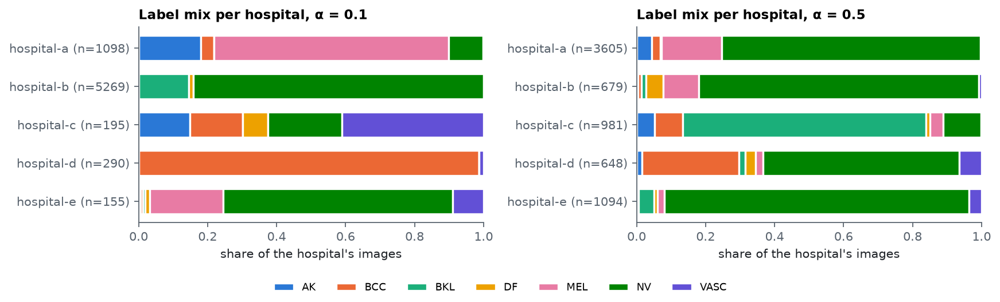
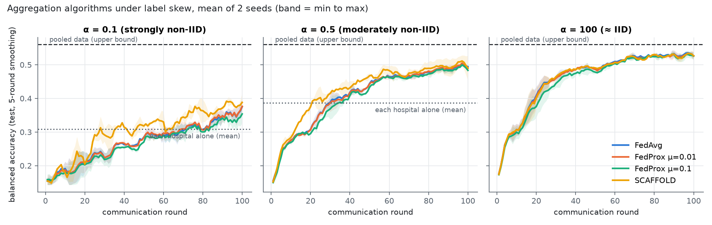
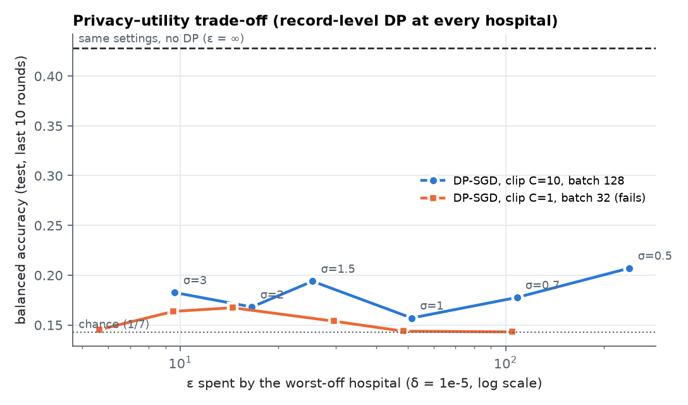
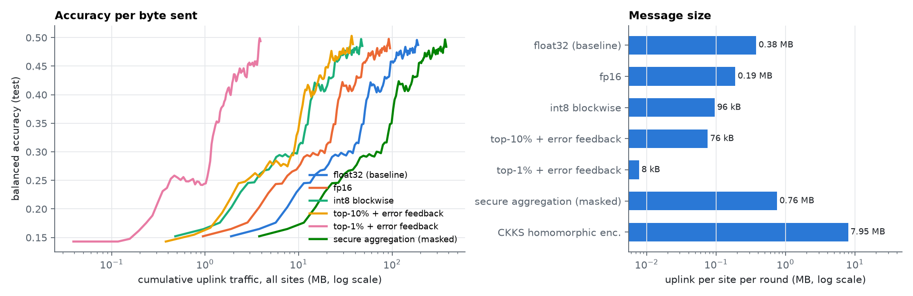
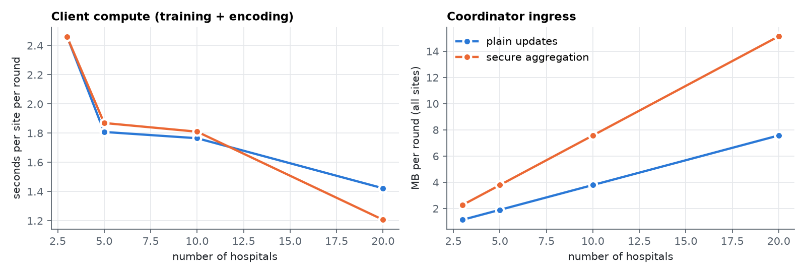

# Results

Every number below is reproduced by `make experiments plots`: 57 runs, about 3 h on a
16-core CPU-only workstation. Raw per-round logs are in `results/runs/*.json`, and the
tables are generated into `results/summary.md`.

**Setup.** DermaMNIST (HAM10000 at 28×28, 7 classes, 67% nevi). There are 5 hospitals,
split with Dirichlet(α) label skew. The model is a small GroupNorm CNN with 94,599
parameters. Each round runs K = 50 local SGD steps (lr 0.1, batch 32) with class weights
from the federated label histogram. Training runs for 100 rounds, and results are scored
on the official held-out test set (2,005 images).

**Metric.** The headline metric is **balanced accuracy**, the mean per-class recall,
where chance is 1/7 = 0.143. Plain accuracy is misleading here: predicting "nevus" for
every image already scores 66.9%. Tables report the mean of the last 10 rounds, as
mean ± sd over 2 seeds where seeds were run.

> Scope: these are single-host simulations of a proof of concept. Two seeds give a first
> indication of variance, not statistical significance. Differences under ~0.02 should be
> read as "no measurable difference".

## 1. Aggregation under non-IID data

| Method | α = 0.1 (strongly non-IID) | α = 0.5 (moderately non-IID) | α = 100 (≈ IID) |
|---|---|---|---|
| FedAvg | 0.355 ± 0.016 | 0.494 ± 0.006 | 0.530 ± 0.006 |
| FedProx μ=0.01 | 0.354 ± 0.019 | 0.497 ± 0.007 | 0.528 ± 0.008 |
| FedProx μ=0.1 | 0.336 ± 0.020 | 0.491 ± 0.004 | 0.525 ± 0.011 |
| SCAFFOLD | **0.384 ± 0.008** | 0.501 ± 0.022 | 0.526 ± 0.009 |
| Pooled data, no federation (upper bound) | 0.560 (final 0.570, accuracy 76%) | | |
| Each hospital alone, α=0.1 (mean of 5) | 0.309 | | |
| Each hospital alone, α=0.5 (mean of 5) | 0.387 | | |

What this shows:

* **Federation pays off.** At α = 0.5, every federated method reaches about 0.49 against
  0.39 for a hospital training alone, without any image leaving its site. Under
  near-IID data, FedAvg recovers 95% of the pooled-data result (0.53 vs 0.56).
* **Label skew costs a lot.** Moving from α = 100 to α = 0.1 drops FedAvg from 0.53 to 0.36,
  and the strongly skewed federation barely beats isolated training (0.31). This is client
  drift: each hospital pulls the model towards its own dominant class.
* **SCAFFOLD is the only method that helps under strong skew.** At α = 0.1 it gains
  about +0.03 over FedAvg, with lower variance. It is also ahead for the first ~50
  rounds at α = 0.5. Under IID data it brings nothing, as expected, since there is no
  drift to correct.
* **FedProx does not help here.** μ = 0.01 is indistinguishable from FedAvg, and
  μ = 0.1 is slightly worse because it slows local progress. The FedProx paper's gains
  come mostly from heterogeneous *systems*, where clients do different amounts of
  work. That source of heterogeneity was removed on purpose with a fixed K, so this
  result is consistent with the paper.
* **Lesson from development.** Epoch-based local training gave the largest site 30×
  more steps than the smallest and made SCAFFOLD diverge. A fixed number of local
  steps, the setting the SCAFFOLD paper uses, fixed it.

## 2. Differential privacy

Each hospital runs record-level DP-SGD (Opacus) with Poisson sampling, per-sample
clipping and Gaussian noise. ε is computed with the RDP accountant at δ = 10⁻⁵ over
all rounds and is reported for the **worst-off hospital**. That is the smallest
site, because its sampling rate is highest. Data split: α = 0.5, 50 rounds.

| setting | noise σ | ε (worst site) | balanced acc | accuracy |
|---|---|---|---|---|
| C=10, B=128, K=20, 50 rounds | 3.0 | 9.6 | 0.182 | 0.600 |
| | 2.0 | 16.6 | 0.168 | 0.640 |
| | 1.5 | 25.5 | 0.194 | 0.589 |
| | 1.0 | 51.4 | 0.157 | 0.656 |
| | 0.7 | 108.3 | 0.178 | 0.663 |
| | 0.5 | 240.1 | 0.207 | 0.646 |
| same settings, **no DP** | – | ∞ | **0.428** | 0.671 |
| C=1, B=32, K=50, 100 rounds (first attempt) | 0.6–3.0 | 5.6–105 | 0.14–0.17 | 0.47–0.67 |

**The honest result: on this setup, record-level DP-SGD destroys most of the utility.**
At every ε tested, including ε ≈ 240, which is no meaningful guarantee, balanced
accuracy stays between 0.16 and 0.21. Without DP the same settings reach 0.43.
Accuracy of around 65% shows the DP models fall back towards predicting the majority
class. Why this happens, and what would fix it:

* **Small sites.** The smallest hospital has 648 images, so a batch of 128 samples
  20% of its data per step. The accountant charges a high ε for that sampling rate,
  and the noise is large relative to the averaged gradient. DP-SGD works well when
  each party holds tens of thousands of records.
* **Training from scratch at 28×28.** All 95k parameters are noised. The standard remedy
  is to pretrain on public data and fine-tune only a small head under DP. That is the
  first thing I would try next.
* **Clipping matters more than σ.** My first sweep clipped at C = 1 while typical
  per-sample gradient norms were 5–20. Every run fell to chance level, whatever the
  noise. Measuring gradient norms and re-tuning to C = 10 with larger batches was what
  moved the curve above chance at all. The failed sweep is kept in the plot on purpose.
* **Rare classes suffer first.** DP noise drowns the gradient signal from classes with
  only a handful of examples per site. That is exactly what balanced accuracy measures.

What the code does provide is correct per-hospital accounting across rounds (ε grows
monotonically and is persisted per client), and DP that composes with all three
algorithms and with secure aggregation.

## 3. Communication and energy

Data split: α = 0.5, FedAvg, 100 rounds. Bytes are measured on the real wire format.

| Uplink encoding | MB / site / round | total uplink (100 rounds) | balanced acc | rounds to 0.30 | energy (kWh, CodeCarbon est.) |
|---|---|---|---|---|---|
| float32 (baseline) | 0.379 | 189 MB | 0.488 | 11 | 0.0056 |
| fp16 | 0.189 | 95 MB | 0.489 | 11 | 0.0054 |
| int8 blockwise | 0.096 | 48 MB | 0.488 | 11 | 0.0055 |
| top-10% + error feedback | 0.076 | 38 MB | 0.490 | 11 | 0.0053 |
| top-1% + error feedback | 0.008 | 4 MB | 0.479 | 31 | 0.0053 |
| secure aggregation (masked) | 0.757 | 378 MB | 0.487 | 11 | 0.0048 |
| CKKS homomorphic encryption (benchmark only) | 7.95 | – | – | – | – |

* **int8 and top-10% are free.** Uplink drops 4–5× with no measurable accuracy cost.
* **Top-1% with error feedback** cuts the uplink 47× and still reaches 0.48. It needs
  about 3× more rounds to reach 0.30, so it fits slow or metered links such as an
  edge node on 4G, rather than latency-bound settings.
* **Secure aggregation costs 2× bandwidth and nothing in accuracy.** Masked values are
  64-bit fixed point. The result matches float32 to within 1.4·10⁻⁷.
* **Energy.** A full 100-round, 5-hospital run costs about 0.005 kWh, well under 1 g CO₂e on
  the Swiss grid. This is a CodeCarbon estimate on a shared machine, so the
  differences between rows are within noise. Compute dominates over networking at
  this model size.

### Secure aggregation vs homomorphic encryption

| | pairwise masking (used) | CKKS (TenSEAL, benchmark) |
|---|---|---|
| bytes per site per round | 0.76 MB (2×) | 7.95 MB (21×) |
| client time | 5 ms mask | 200 ms encrypt |
| server time | 1.7 ms | 27 ms add + 53 ms decrypt |
| max error vs plain sum | 1.4·10⁻⁷ | 2.1·10⁻⁸ |
| who can decrypt | nobody needs to: the masks cancel | the secret-key holder. A single key holder is a trust problem, so production would need threshold keys |

Masking is the better fit for a sum. HE becomes worth its cost only when the server
must compute more than a sum on encrypted data.

## 4. Scalability (3 to 20 hospitals)

| sites | client time / round, plain (s) | client time / round, secagg (s) | uplink / round, plain (MB) | uplink / round, secagg (MB) |
|---|---|---|---|---|
| 3 | 2.46 | 2.46 | 1.1 | 2.3 |
| 5 | 1.81 | 1.87 | 1.9 | 3.8 |
| 10 | 1.76 | 1.81 | 3.8 | 7.6 |
| 20 | 1.42 | 1.21 | 7.6 | 15.1 |

* Coordinator ingress grows linearly with the number of sites, as expected.
* Client time per round stays roughly flat because K is fixed. The downward trend is load
  noise, since these runs shared the machine with the DP sweep.
* All-pairs masking adds no visible compute at 20 sites. Each client derives n − 1
  ChaCha20 streams, at about 1 ms each. Above roughly 100 sites, the O(n²) key exchange
  and the lack of dropout tolerance matter more. Bonawitz et al. (Shamir-shared seeds)
  and Bell et al. (O(log n) neighbours) address both.

## 5. Security results

The security claims are tested rather than measured. `tests/test_security.py` has 14
attack tests: missing client certificate, certificate from a rogue CA, impostor
server, revoked certificate (CRL), stolen token used with another certificate, forged
HS256 token, expired token, observer role trying to fetch the model, malformed or
oversized or wrong-round updates, and audit-log completeness. It also includes two full
federations over mTLS, one with secure aggregation. The threat model, including what an
honest-but-curious coordinator still learns, is in
[docs/THREAT_MODEL.md](docs/THREAT_MODEL.md).

## Limitations

* The work is simulated on one host. The docker run uses isolated networks on one machine,
  not separate institutions.
* There are 2 seeds per configuration and 1 seed for the DP, compression and scalability
  suites.
* The model is small and inputs are 28×28. Absolute numbers are far below
  dermatology state of the art, which uses pretrained CNNs at 224×224 and reaches
  0.8–0.9 balanced accuracy on HAM10000. The goal here was the *comparison* between
  methods.
* Secure aggregation assumes an honest-but-curious server and no dropouts.
