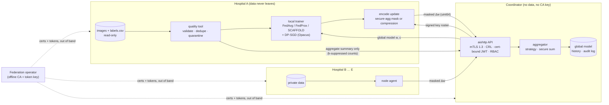
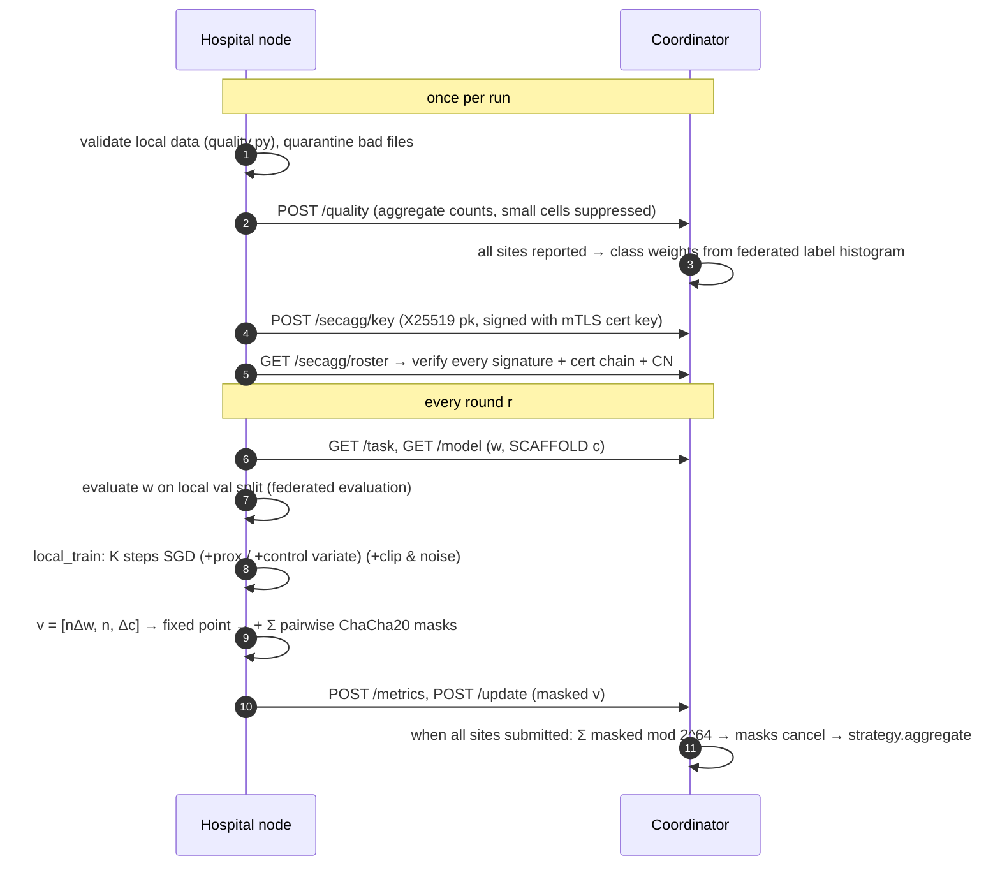

# Architecture

## One round, step by step

## Code map

| Module | Responsibility |
|---|---|
| `data.py` | DermaMNIST download (checksum-verified), Dirichlet non-IID split, export per hospital, planted faults |
| `quality.py` | on-site validation: missing, corrupt, wrong size or mode, bad label, exact and near duplicates, low contrast; local report vs shared summary |
| `models.py` | small GroupNorm CNN (≈95k params), flat-vector helpers |
| `train.py` | client side of FedAvg / FedProx / SCAFFOLD, DP-SGD via Opacus, evaluation |
| `strategies.py` | server side aggregation for the three algorithms |
| `compression.py` | fp16, blockwise int8, top-k + error feedback |
| `secagg.py` | X25519 + HKDF + ChaCha20 pairwise masks, signed rosters |
| `he.py` | CKKS (TenSEAL) encrypted aggregation benchmark |
| `serialization.py` | pickle-free wire format |
| `pki.py`, `auth.py` | CA, certs, CRL, cert-bound EdDSA JWTs, policy |
| `server/app.py` | coordinator (aiohttp, TLS 1.3, RBAC, audit log, update validation) |
| `node/agent.py` | hospital agent |
| `simulation.py` | in-process runner for benchmarks: same client, strategy and wire code, real byte counts, CodeCarbon |
| `flower_app/` | the same client code behind Flower's `ClientApp` / `ServerApp` |

## Design decisions

* **Own transport plus a Flower front-end, not Flower alone.** Flower's SuperLink supports
  server-side TLS and node authentication with public keys. The goal here was
  certificate-based identity, access control and authorisation, and building that layer by hand makes
  every security decision visible and testable. The Flower app shows that the
  ML code is framework-agnostic.
* **Algorithm corrections as parameter-space steps.** FedProx (exact proximal step) and
  SCAFFOLD (control-variate correction) are applied *after* the optimiser step. They
  depend only on the global model, so they cost no privacy budget and compose with
  Opacus' per-sample clipping without touching its gradient hooks.
* **Fixed local steps, not epochs.** With very unequal hospital sizes (155 to 5,269 images at
  α = 0.1), epoch-based training gives large sites 30× more local steps, which made SCAFFOLD
  unstable in early tests. A fixed K = 50 steps per round is the setting of the original
  SCAFFOLD paper.
* **Balanced accuracy as the headline metric.** 67% of HAM10000 is benign nevi, so a
  constant classifier scores 66.9% accuracy. Balanced accuracy was the ISIC 2018 challenge metric.
  Class weights come from the *federated* label histogram in the quality reports, so
  no extra information is shared.
* **Secure aggregation and robust aggregation conflict.** With masking on, the server cannot
  norm-check individual updates. The code makes the trade-off explicit: norm bounds apply
  only to plain updates, and DP's clipping bounds each sample's influence in both modes.
